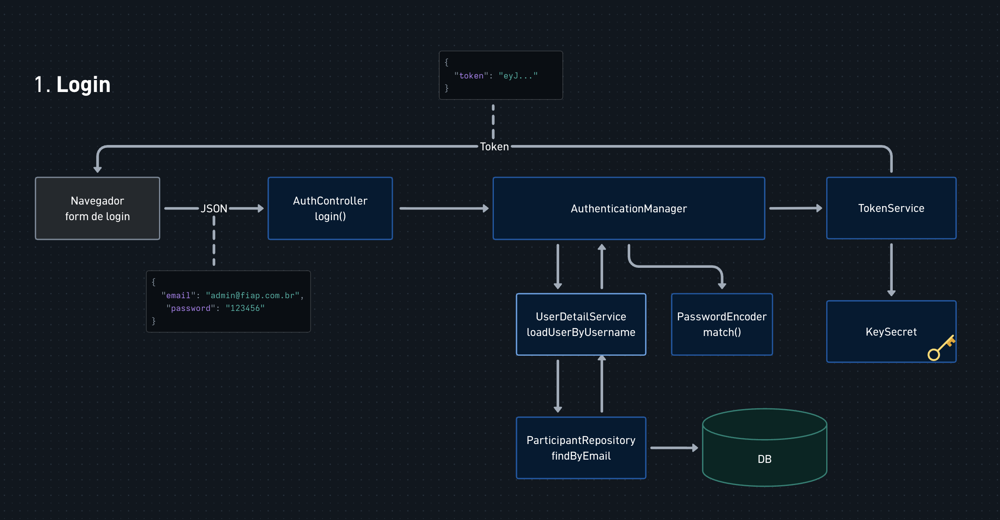
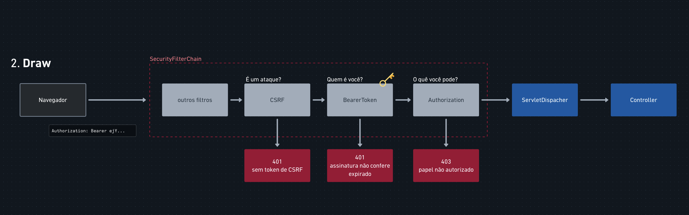

# Projeto Amigo Secreto

Projeto de exemplo da aula de Java da FIAP

Tópicos abordados:
- Spring Data JPA
- Spring Security

## Arquitetura

*Processo de Autenticação* 

*Processo de Autorização*

